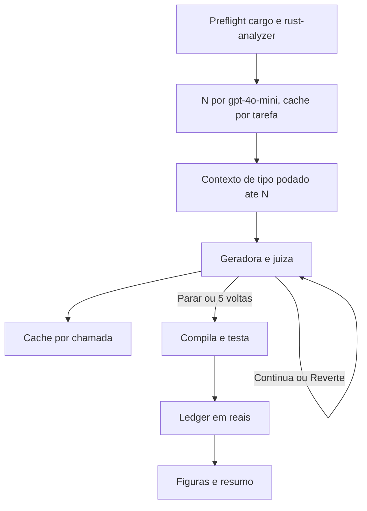

# Execução da contribuição

## Branch

Tudo abaixo acontece em `dev-davi`. Nada novo entra na `main`.

O commit já enviado é `c8260a8` (`docs: add AGENTS.md and update .gitignore`, Davi-SB). `main` e `origin/main` estão nele. O pai é `47e841e` (juíza Gemini). Há ainda trabalho local fora desse commit: `docs/` sem rastrear e `AGENTS.md` modificado. Esse trabalho fica na árvore e segue para `dev-davi`; não volta para a `main`.

Ordem, antes de qualquer código:

- `git checkout -b dev-davi` em `c8260a8`, levando os arquivos ainda não commitados.
- `git push -u origin dev-davi`.
- Com o checkout em `dev-davi`, `git branch -f main 47e841e`.
- `git push --force origin main`, para `origin/main` voltar a `47e841e` e o `c8260a8` existir só em `dev-davi`.

Esse force push reescreve a `main` remota. É o que tira o commit de lá. Quem já tiver puxado `c8260a8` fica divergente da `main`.

Os commits seguintes (código, resultados, figuras) nascem em `dev-davi`.

O contrato já está em [docs/arquitetura.md](docs/arquitetura.md) e [docs/experimentos.md](docs/experimentos.md). O código em [catcoder/rust/evaluation.py](catcoder/rust/evaluation.py) ainda é o laço Gemini do commit `47e841e` (nota 0–10, 10 iterações, contexto pré-calculado, sem cache). A execução troca esse laço pelo ciclo documentado e não mexe nos JSON do artigo em `results/java` e `results/rust`.

A rodada de experimentos segue [docs/experimentos.md](docs/experimentos.md), não o teto provisório de 10 tarefas da seção Decisões. Os tetos que o código aplica são os da tabela: 1 trajetória, 5 voltas, 5 tentativas, N de 0 a 4, 16 trechos, cortes de caracteres, `max_output_tokens` 32 / 1024 / 256, e R$ 20 no total.

## Código

Novo pacote [catcoder/contribuicao/](catcoder/contribuicao/), sem reescrever o retriever nem o template Jinja.

- `limites.py` espelha os números das duas docs (modelos `gpt-4o-mini` e `gpt-5`, índices com `random.Random(0)`, preços e cotação 5,57).
- `ciclo.py` roda uma trajetória. A juíza devolve só JSON `{"acao": "continua"|"reverte"|"parar", "versao": id, "feedback": "..."}`. Continua revisa a versão corrente. Reverte revisa o id anterior que ela indicar. Parar, ou o fim da 5ª volta, entrega essa versão. A geradora recebe o prompt `[CONTEXT]` + `[CODE]` e uma única versão. A chave sai de `OPENAI_API_KEY` no ambiente. Toda chamada manda `max_output_tokens`. O pacote `openai` já está em [catcoder/requirements.txt](catcoder/requirements.txt); se o pin 1.25.2 recusar o parâmetro dos modelos novos, a chamada usa o nome equivalente aceito pelo SDK, sem trocar de modelo.
- Busca híbrida: usar `rag_data` já gravado no dataset (é a saída do `EnsembleRetriever` 0.7/0.3). Cortar em 16 trechos de 1_000 caracteres. Não reindexar.
- Grau N no Rust: parâmetro `degree` em `Context.build` ([catcoder/tools/intellirust/intellirust/context.py](catcoder/tools/intellirust/intellirust/context.py)). N=1 fica nos tipos da assinatura; cada grau a mais repete o salto que hoje está fixo no segundo laço (`query_typedef`). `make_ctx` em [catcoder/rust/extract_type_context.py](catcoder/rust/extract_type_context.py) recebe N. O texto final é cortado em 12_000 caracteres. Cache em disco por `(rust, indice, N)`.
- Java: o analisador do artigo não tem grafo por grau e permanece assim. A rodada Java usa `extended_context` e `rag_data` do dataset, com os mesmos cortes de caracteres, e registra o N pedido pela LLM. A legenda da figura diz que a poda por grau vale para o Rust.
- [catcoder/rust/evaluation.py](catcoder/rust/evaluation.py) deixa de chamar Gemini. O ponto de entrada dos experimentos é `python -m catcoder.contribuicao.run`.

Cache em `results/contribuicao/cache/`, um JSON por chamada (`lingua`, `indice`, papel, volta, modelo, hash do prompt). Retomada lê esse JSON e não chama a API de novo. A escolha de N é a mesma nas três rodadas da língua, então uma tarefa paga essa chamada uma vez só. O arquivo da tarefa só fica `completo` depois do teste. Interromper no meio de uma tarefa reaproveita as chamadas já gravadas e segue na volta seguinte.

Ledger `results/contribuicao/ledger.json`: tokens medidos na resposta e reais a 5,57. Antes de cada tarefa, reserva dela (R$ 0,10, R$ 0,46 ou R$ 1,00, conforme o par) somada ao que já foi medido. Se passar de R$ 20, a tarefa não começa e as rodadas seguintes não começam. Tentativas de rede entram na reserva da tarefa.

Teste da tarefa: Rust usa `TestAdapter.test` (o `communicate` do commit `1cd0182`, em sequência). Java usa `Defects4J` em [catcoder/java/test_adapter.py](catcoder/java/test_adapter.py). Sucesso é compilar e passar em todos os testes. Também ficam registrados compilação, voltas, ações, N pedido e N usado, código entregue e custo.

Um `selfcheck.py` com cliente falso confere o corte de contexto, o teto de R$ 20 e a retomada sem segunda chamada. Roda antes de qualquer chamada paga.

## Preflight, antes de gastar

Nesta máquina não há `cargo`, `rust-analyzer` nem `defects4j` no PATH, e o Python atual não tem `openai` nem `datasets`.

- Ambiente do [catcoder/requirements.txt](catcoder/requirements.txt) mais `matplotlib` para as figuras.
- Rustup com `cargo` e `rust-analyzer`, senão a rodada Rust não começa: sem isso não há teste nem poda de grau.
- Java só começa se `defects4j checkout` funcionar num bug de prova. Sem isso, as três rodadas Java não disparam chamada. A reserva delas (R$ 7,74) não é transferida para mais tarefas Rust.

## Rodadas

Ordem de [docs/experimentos.md](docs/experimentos.md): R-FF (46, mini/mini), R-JF (8, mini/gpt-5), R-FFORTE (4, gpt-5/gpt-5), depois J-FF (30), J-JF (6), J-FFORTE (2), se o preflight Java passar. Os índices fortes são o prefixo da amostra `random.Random(0)`.

## Resultados

Tudo sob `results/contribuicao/`, sem alterar os JSON do artigo.

- `tarefas/*.json` com os campos do registro em [docs/experimentos.md](docs/experimentos.md).
- `resumo.json`: por rodada, taxa de sucesso, taxa de compilação, média de voltas, média de N, contagem de Continua/Reverte/Parar, tokens e reais. A taxa de sucesso não é misturada ao pass@1 do artigo.
- `figuras/generalizacao.png` e `figuras/ablacao.png`. Painel do artigo: `lastest_eval.pass@1` lido de `results/{java,rust}/{infile,repocoder,catcoder,-cr,-tc}/`. A média Java é a média dos seis JSON presentes. Rust e a ablação `-cr`/`-tc` só têm CodeLlama-13B neste checkout; as outras barras do slide ficam de fora, com nota na figura, sem leitura do screenshot. Painel da contribuição: as seis taxas de sucesso, com n na legenda (46, 8, 4 e 30, 6, 2). Modelos da OpenAI não entram no eixo de CodeLlama. A ablação da contribuição é só o sistema completo, como o documento fixa.
