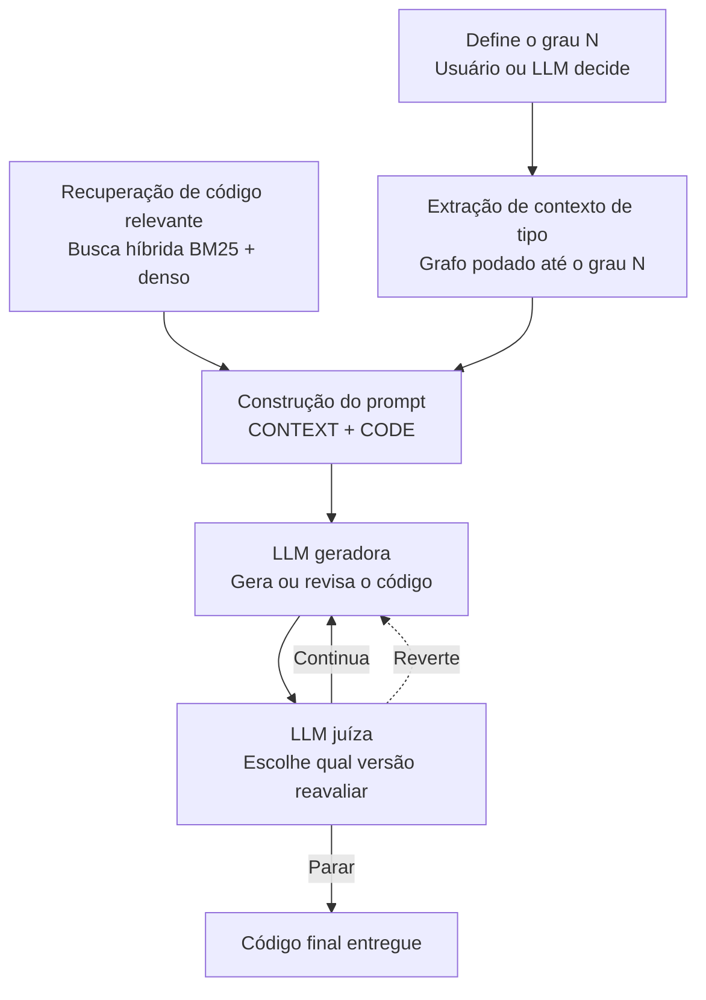

# Arquitetura proposta

Contribuição do grupo sobre o CatCoder. O artigo recupera código relevante, extrai contexto de tipo com profundidade fixa, monta um prompt e gera o corpo da função em uma passada. Esta arquitetura mantém a recuperação híbrida e o prompt `[CONTEXT]` + `[CODE]`, torna o grau do grafo de tipos uma decisão (do usuário ou de uma LLM) e coloca a geração num ciclo em que uma LLM juíza escolhe qual versão a LLM geradora reavalia.

## Fluxo

Duas frentes correm até a construção do prompt. A recuperação de código não depende do grau. O grau N só afeta a extração de tipos. As duas saídas entram no mesmo prompt. Daí para baixo a geração é iterativa: a geradora produz ou revisa uma versão, a juíza escolhe o que fazer com ela, e só a ação Parar entrega o código.



Continua é a volta cheia: a versão corrente segue para nova revisão. Reverte é a volta tracejada: a juíza descarta a versão corrente e devolve uma versão anterior à geradora. Parar encerra e entrega o código final.

## Etapas

### Recuperação de código relevante

Busca híbrida no repositório da função focal, a mesma do CatCoder: índice denso e BM25 fundidos por `EnsembleRetriever`, com pesos 0.7 para o denso e 0.3 para o BM25, `k=8` em cada um. A consulta é a dica da tarefa mais a assinatura. O corpo verdadeiro da função focal fica de fora do índice.

Saída: trechos de código do repositório, com o caminho de origem. Esse material entra em `[CONTEXT]` e não passa pelo grau N.

Módulo: `catcoder/rust/retrieve_relevant_code.py` (`run_rag`, `RustProjectIndexer`).

### Definição do grau N

N é a profundidade até a qual o grafo de tipos da função focal é mantido. A decisão acontece antes da extração e tem dois modos:

- o usuário informa N;
- uma LLM escolhe N para a tarefa.

A etapa emite um inteiro. Ela não extrai tipos e não altera a busca de código. O inteiro fica limitado pelo teto da seção Decisões.

No CatCoder essa profundidade está cravada no extrator (tipos da assinatura mais um salto interno; impls podados com `max_levels=1`). Aqui N é entrada da extração.

### Extração de contexto de tipo

O grafo de tipos parte da assinatura da função focal (parâmetros, retorno e tipos ligados a ela pelo rust-analyzer). A extração poda esse grafo até o grau N e serializa o que restou: definições de tipo e impls dentro do limite.

Saída: texto de contexto de tipo, que também entra em `[CONTEXT]`.

Módulos: `catcoder/rust/extract_type_context.py` (`make_ctx`) e `catcoder/tools/intellirust/intellirust/context.py` (`Context.build`). A poda já existe em `TreeNode.prune_forest` (`file_structure.py`); a proposta faz o limite acompanhar N.

### Construção do prompt

Junta as duas frentes no formato do artigo:

```
[CONTEXT]
<contexto de tipo podado até N>
<código relevante da busca híbrida>
[/CONTEXT]
[CODE]
<docstring>
<assinatura da função focal>
```

Template: `catcoder/rust/prompts/codegen`, renderizado por `build_prompt` em `catcoder/rust/util.py`.

Na primeira geração o prompt é esse. Nas voltas do ciclo, a geradora recebe de novo esse prompt junto com a versão que a juíza escolheu reavaliar.

### LLM geradora

Gera o corpo da função, ou revisa a versão que a juíza devolveu.

- Primeira entrada: o prompt `[CONTEXT]` + `[CODE]`. Saída: uma versão nova.
- Entrada seguinte, depois de Continua: o mesmo prompt e a versão corrente, para revisão.
- Entrada seguinte, depois de Reverte: o mesmo prompt e a versão anterior escolhida pela juíza, para revisão a partir dela.

Cada chamada acrescenta uma versão ao histórico do ciclo. A geradora não decide parar.

### LLM juíza

Recebe o prompt, o histórico de versões e a versão recém-produzida. Escolhe qual versão reavaliar e devolve uma de três ações.

| Ação | Seta no fluxo | Efeito |
|---|---|---|
| Continua | cheia, de volta à geradora | A versão corrente permanece a escolhida. A geradora a revisa. |
| Reverte | tracejada, de volta à geradora | A versão corrente sai de cena. A juíza indica uma versão anterior do histórico, e a geradora revisa essa. |
| Parar | para baixo | O ciclo acaba. A versão escolhida pela juíza é o código final entregue. |

A juíza precisa do histórico para Reverte ter o que escolher. Uma nota isolada sobre a última amostra não é essa decisão: Continua, Reverte e Parar são a saída da etapa. O que vai no prompt dela cabe nos tetos da seção Decisões: a memória local guarda a versão inteira, e o prompt recebe um recorte.

### Código final entregue

A versão selecionada na ação Parar. É a saída da arquitetura para aquela tarefa.

## O que entra em cada ciclo

Por tarefa, o ciclo guarda:

- o prompt já montado (`[CONTEXT]` + `[CODE]`);
- o histórico de versões, cada uma com o código produzido pela geradora;
- a ação da juíza e, no caso de Reverte, qual versão anterior ela devolveu.

A recuperação e o grau N ficam fora do ciclo. N e o código relevante são fixados antes do primeiro prompt. Uma volta Continua ou Reverte não recalcula a busca nem o grafo.

## Relação com o CatCoder

| Peça | CatCoder do artigo | Esta proposta |
|---|---|---|
| Código relevante | Busca híbrida BM25 + denso | A mesma busca |
| Contexto de tipo | Profundidade fixa no extrator | Grafo podado até um grau N |
| Quem escolhe a profundidade | Ninguém; está no código | Usuário ou LLM, antes da extração |
| Prompt | `[CONTEXT]` + `[CODE]` | O mesmo formato |
| Geração | `n` amostras independentes, uma passada | Uma trajetória: gerar e revisar |
| Seleção do resultado | pass@k sobre as amostras | A juíza escolhe a versão e a ação Parar entrega o código |

A superfície de implementação desta proposta é o pipeline Rust (`catcoder/rust/` e, para o grau N, `catcoder/tools/intellirust/`). O pipeline Java permanece o do artigo.

## Decisões

Tetos fixos para a implementação. Servem para impedir que uma execução estoure a janela de contexto ou dispare cobrança imprevista de tokens. Valor pedido acima do teto é cortado para o teto, e a execução segue com o valor cortado. Chamada de API sem `max_output_tokens` explícito não sai.

Os números abaixo são o contrato desta proposta. Subir um teto é mudança desta seção, antes de mudar o código.

### Chamadas

| Parâmetro               | Explicação                                                                    | Máximo                         | Efeito no custo                                                                                                 |
| ----------------------- | ----------------------------------------------------------------------------- | ------------------------------ | --------------------------------------------------------------------------------------------------------------- |
| Tarefas por execução    | Quantidade de funções do dataset processadas numa rodada                      | 10 (provisório)                | Corta o dataset antes de qualquer chamada                                                                       |
| Trajetórias por tarefa  | Quantas vezes o ciclo geradora/juíza roda para a mesma função                 | 1                              | Uma passagem do ciclo. O `n=10` do artigo são amostras independentes e não se multiplica em cima deste ciclo    |
| Voltas geradora + juíza | Ida e volta entre gerar ou revisar e julgar, dentro de uma trajetória         | 5                              | Cada volta são duas chamadas. No fim das 5, a última versão escolhida é entregue como se a juíza tivesse parado |
| Tentativas por chamada  | Repetições da mesma chamada quando a API falha                                | 5                              | A primeira mais duas repetições. Erro de rede ou de cota não reabre a chamada além disso                        |
| Chamada para escolher N | Chamada em que a LLM devolve só o inteiro do grau, antes da extração de tipos | 1 por tarefa, e só no modo LLM | No modo usuário essa chamada não existe                                                                         |

Pior caso de uma execução, com N escolhido por LLM e nenhuma parada antecipada: 10 tarefas × (1 + 5 + 5) = 110 chamadas.

### Saída de cada chamada

| Chamada | Explicação | `max_output_tokens` |
|---|---|---|
| Escolha de N | Teto da resposta que contém apenas o inteiro N | 32 |
| Geradora | Teto do corpo de código devolvido numa geração ou revisão | 1024 |
| Juíza | Teto da decisão devolvida numa avaliação: ação e versão escolhida | 256 |

Pior caso de saída por tarefa: 32 + 10 × 1024 + 10 × 256 = 12_832 tokens. Em 10 tarefas, 128_320 tokens de saída.

A escolha de N recebe só a assinatura e a docstring, até 2_000 caracteres no total. O repositório, o grafo e o código recuperado ficam de fora dessa chamada.

### Entrada de cada chamada

| Parâmetro                                           | Explicação                                                                  | Máximo |
| --------------------------------------------------- | --------------------------------------------------------------------------- | ------ |
| Grau N                                              | Profundidade do grafo de tipos que entra no contexto                        | 4      |
| Trechos de código no prompt                         | Snippets da busca híbrida colocados em `[CONTEXT]`                          | 16     |
| Caracteres de cada trecho                           | Tamanho de um snippet depois do corte                                       | 1_000  |
| Caracteres do contexto de tipo já podado            | Tamanho do texto de tipos colocado em `[CONTEXT]`                           | 12_000 |
| Caracteres de docstring + assinatura                | Tamanho do bloco `[CODE]` com a documentação e a assinatura da função focal | 2_000  |
| Caracteres de uma versão guardada na memória        | Tamanho do código completo de uma versão armazenada no ciclo                | 6_000  |
| Versões citadas no prompt da juíza                  | Quantas versões do histórico a juíza vê numa chamada                        | 10     |
| Caracteres de cada versão dentro do prompt da juíza | Tamanho do recorte de cada versão enviado à juíza                           | 1_500  |

A geradora, nas voltas, recebe uma versão só: a que a juíza escolheu. O histórico completo não volta para ela.

A juíza escolhe pelo identificador da versão. O corpo que ela lê é o recorte de 1_500 caracteres. A versão completa, até 6_000 caracteres, permanece na memória local e é essa que a geradora recebe depois de Continua ou Reverte.

O artigo usa `k=8` e `chunk_size=1000` na busca Rust, e `max_new_tokens=512` na inferência. Os tetos de trechos e de caracteres por trecho acompanham esses dois. O teto de saída da geradora fica em 1024, acima dos 512 do artigo, porque o ciclo revisa um corpo já existente e precisa de espaço para devolvê-lo inteiro. N máximo 3 fica um passo acima da profundidade fixa do extrator atual.
